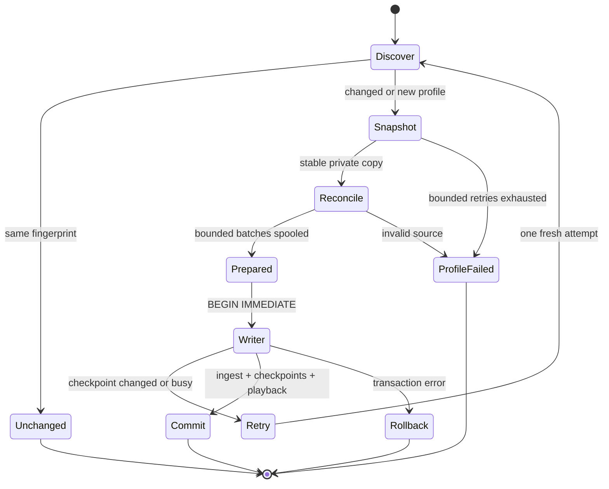
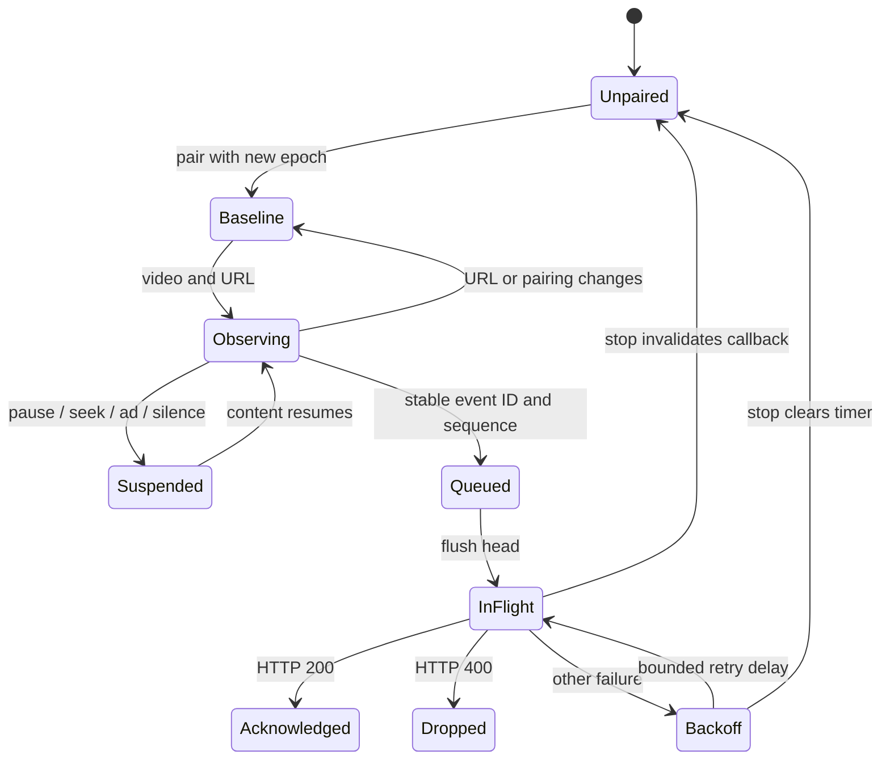

# Runtime state machines

This inventory covers the shipped Rust CLI, collector, database, playback listener,
Windows helper and desktop window, `ui/app.js`, and `userscripts/omoi.user.js`.
Prototype pages and build tools are outside application runtime. Review date:
2026-11-03, schema version 3.

The tables identify 60 state owners. A machine need not be an enum: flags, persisted
rows, callbacks and resource ownership also define states and transitions. Machines
can be nested or share a transaction. This is a source-level inventory, not a claim
that every possible interleaving or OS failure has been executed.

## Collection and storage

Paths below are relative to the repository root.

| ID / owner | States and transitions | Invariant and recovery |
|---|---|---|
| 01 CLI — `src/cli.rs`, entry points | arguments → command → result → exit | Validate before work; partial collection, contention and unsupported platform have distinct exits. Helper requires absolute home. |
| 02 Config parser — `src/config.rs` | string/escape/comment/key/value → accepted/rejected | Restricted grammar and bounds; invalid config fails rather than broadening discovery. |
| 03 Home resolution — `src/paths.rs` | explicit override / OS roots → paths/error | Override wins; required roots validated; resolution does not collect. |
| 04 Discovery — `src/readers/discover.rs` | roots → canonical candidates → selected/excluded/missing/failed | Canonical identities deduplicate; selectors/exclusions bound scope. Missing differs from inaccessible. |
| 05 Firefox profile parser — discovery | section → fields → flush → resolved/skipped | Flush at next section and EOF; relative/absolute paths separate; unused profiles produce warnings. |
| 06 Checkpoint — `src/readers/mod.rs`, `src/collect.rs` | absent/default / supported/loaded / malformed/error | Version validated. Fingerprint is a skip hint, not proof all older rows were seen. |
| 07 Collection attempt — `src/collect.rs` | prepare → write → complete/partial/busy/fatal | Busy retries once from fresh preparation. Successful profiles may commit with a partial result. |
| 08 Dry run — collector | private DB → copy existing → migrate → simulate → cleanup | Ingestion writes only the private DB; selected browser snapshots are still real reads. |
| 09 Temp ownership — `src/readers/snapshot.rs` | exclusive allocation → owned → cleanup | Bounded collision attempts; clean only owned paths. Process death may leave temp directories. |
| 10 Snapshot — snapshot reader | stamp → copy main/WAL/journal → restamp → stable/retry/fail | Never write source files; bounded retries. Equal size/mtime is a heuristic, not a hash. |
| 11 Reader lifecycle — `src/readers/sqlite.rs` | open copy → recovery → query-only → integrity/schema check → read → close | Recovery affects copy only; bad source rejects that profile. |
| 12 Reconciliation — collector/SQLite reader | unchanged/skip; changed → minimum tuple → pages → exhausted | Replay changed snapshots in bounded batches; discover backfills, replacement prefixes and mutable observations. Tuple cursor is within this snapshot only. |
| 13 Spool — collector | candidates → complete/failed → publish/discard | Never publish a partial failed-profile spool. Memory batch-bounded; disk stores spool/snapshots. |
| 14 Publication — collector | prepared checkpoint → immediate writer → compare → ingest/checkpoint → commit/rollback | Checkpoint comparison prevents stale concurrent publication. Items/views/FTS/checkpoints/playback share commit. |
| 15 Connection — `src/db/mod.rs` | read-only/writable WAL → active/busy/error → closed | Read-only cannot create DB. Foreign keys, cache and busy timeout explicit. |
| 16 Migration — `src/db/migrations.rs`, `src/db/000*.sql` | v0 → v1 → v2 → v3; foreign/newer → reject | DDL and version atomic. v3 seeds item sequence and adds deletion cutoffs/live-key frontiers; failure rolls back. |
| 17 Item identity — `src/dedupe.rs`, schema 3 | absent/allocate; existing/reuse; deleted/later new identity | Persistent numeric sequence prevents stale edit/delete from targeting a replacement item. |
| 18 Metadata precedence — dedupe/`src/metadata.rs` | empty → observed/browser → higher-ranked/manual | Protect manual values. Winning title and provenance change together. Equal-ranked title keeps existing winner; kind can refine video to short/live. |
| 19 View dedupe — dedupe | no anchor/insert; nearest anchor/merge | Inclusive ±30-minute fixed anchor; deterministic ties; maximum known tab duration; skip unchanged updates. |
| 20 FTS — schema 1 triggers | insert/update/delete → index mutation | Same transaction as item; rollback restores both. |
| 21 Manual edit — metadata | validate → find ID → fields/provenance/tags → commit | Atomic edit; missing ID fails; bounded normalized tags. |
| 22 Deletion — `src/ui.rs`, dedupe/sessionize | live → cutoff → cascade → suppress historical replay | Retain platform/external ID and deletion time. Replay/pending playback at or before cutoff cannot resurrect. Later opening gets a new ID. |
| 23 Maintenance — `src/db/maintenance.rs` | not due/skip; due → optimize → marker | Weekly operation is idempotent; marker follows successful work. |
| 24 Log ownership — `src/logging.rs` | unlocked → OS file lock → write → release handle | Persistent lock pathname is harmless; live handle determines ownership. Contention preserves current owner. |
| 25 Log retention — logging | encode → size check → prune → append/flush | Counter-only records and file/byte caps. Logging failure does not change completed collection result. |
| 26 Export — `src/export.rs`, CLI | read snapshot → ordered stream → temp → sync → exclusive publish | Bounded serialization and no overwrite. Clean owned temp output on error; preserve existing destination. |

## Playback

| ID / owner | States and transitions | Invariant and recovery |
|---|---|---|
| 27 Pairing — `userscripts/omoi.user.js` | unpaired → paired epoch → stop/repair | Repair resets producer/baseline; stop clears queues, aborts request and nulls retry ownership. No unpaired credit. |
| 28 Attachment — userscript | undiscovered → observed video → active/detached | Attach handlers once per element; SPA URL change starts fresh producer. |
| 29 Sampling — userscript | baseline → playing/paused/seeking/ad/silence → sample | Ad/unpaired state resets before accumulation; previous rate accounts previous interval; seeks are not watch time. |
| 30 Emission — userscript | throttled → eligible → event | New identity resets throttle and emits sequence zero; retries preserve IDs/counters. |
| 31 Client queue — userscript | append → full/drop → pending → acknowledged/discarded | At most 32 queues of 256; explicit dropped count; persists across reload in shared manager storage. |
| 32 Transport — userscript | idle → owned attempt → success/reject/backoff | Request object and pairing epoch own callbacks. Ignore stale completion. 400 drops poison head; 200 consumes; other failures back off to 60 seconds. |
| 33 Credential — `src/listener.rs` | protected directory → complete staging file → exclusive publication → valid/rejected | Write and sync before publishing; no concurrent overwrite. Existing malformed token fails explicitly; deliberate rotation required. |
| 34 Listener — listener | bind → token → DB/migration/FULL synchronous → ready → accepts | Loopback only; no readiness before setup. Request errors isolated; durable inbox survives restart. |
| 35 Admission — listener/`src/sessionize.rs` | frame → auth → validate/normalize → enqueue/reject | Exact host/token/route/method/MIME; absent Origin. Invalid=400, forbidden=403, storage failure=503, durable success/duplicate=200. |
| 36 Receipt — sessionize | unseen → inserted/duplicate → commit/rollback | Unique event ID and producer-sequence. Dedupe precedes live-key mutation. Receipt+inbox commit before ack. |
| 37 Live identity — sessionize | unpinned → dated channel key → continuous/stopped/gap → repinned | Continuous broadcast survives midnight. Stop or >5-minute gap permits next dated key. Migrated keys preserve initial continuity. |
| 38 Inbox retention — sessionize | queued → consumed/evicted | Cap 100,000 rows and 20 MB bodies. Eviction removes unprocessed receipt so retry can recover; count dropped. |
| 39 Consumption — sessionize | batch → envelope → deleted/late/accepted → remove raw | Batches of 256; caller transaction. Malformed stored envelope rolls back; check deletion cutoff before materializing. |
| 40 Producer frontier — sessionize | absent → monotonic sequence/time/counter → advance/late reject | Discard and count regressing/equal sequence or regressing time/counter. Persist across reopen. Counter reset requires new producer. |
| 41 Session — sessionize | baseline → adjacent → stopped/different item/long gap → baseline | Adjacency needs same item, previous not stopped and gap ≤300,000 ms. First cumulative counter is baseline, not retroactive credit. |
| 42 Interval credit — sessionize | counter delta → wall-time clamp → positive/zero | Position separate; sum milliseconds then derive seconds; unknown gaps uncredited. |
| 43 Overlap sweep — sessionize | endpoints → active densities → maximum-density integral | Do not sum concurrent tabs. Round integration to milliseconds before whole seconds; sub-interval timing approximate. |

## UI, desktop and scheduling

| ID / owner | States and transitions | Invariant and recovery |
|---|---|---|
| 44 UI bootstrap — `ui/app.js`, `src/ui.rs` | fragment token → remove fragment → info → preferences → render | In-memory token and exact-origin API; restart needs new launch token. Unsupported saved appearance falls back. |
| 45 Page render — UI JS | navigation/filter → epoch/loading → content/error/retry | Only current epoch publishes or clears busy. Stale discovery cannot alter current selection. Empty later history page resets to a valid offset and retries once. |
| 46 Detail ownership — UI JS | request → visible → edit/close/supersede | Detail+page epochs reject late responses; close/native cancel invalidate ownership. |
| 47 Confirmation/mutation — UI JS | ask → cancel/confirm → save/delete → success/error | Clear confirmed action on close. Old completion cannot close newer dialog; error targets only owned form. |
| 48 Collection controls — UI JS | selected → confirmed → collecting → result → refresh | Explicit profiles and one collecting flag; intersect selection with current discovery. |
| 49 Settings request — UI JS | output target → request → reply after navigation | Retain original element; update only if connected, never a replacement/null node. |
| 50 Suggestions — `src/recommend.rs`, UI JS | budget/seed → read snapshot → shelves/empty/error | Local deterministic queries with reasons; continue-watching needs measured position/duration. Keep Clear topic selection available on error, including deleted seeds. |
| 51 Appearance/export client — UI JS | apply → persist/fallback; picker → stream/download → complete/error | Five themes retained; storage failure visible; cancelled picker inert. |
| 52 Server bootstrap — `src/ui.rs` | bind → token/home/config/migration → advertise → serving | Collision before catalogue mutation; readiness only after initialization; startup error propagates. |
| 53 Admission queue — UI server | accept → parked → readable/expired-unreadable/excess dropped | ≤16 retained sockets. Expire silent speculative connections, preserve readable queued work. |
| 54 HTTP framing — UI server | header chunks → unique headers → bounded body → complete/reject | Five-second overall deadline, two-second read inactivity; reject duplicate headers/TE/excess bytes. Short polls allow Windows cancellation. |
| 55 Routing/response — UI server | static/auth API/forbidden → operation → response/disconnect | Transactions finish; response overall deadline 30 seconds plus per-write timeout. Downloads first materialize in owned temp. |
| 56 Server lifetime — UI server | browser active/idle/expire; desktop owned/stop/join/release | Desktop never idle-expires. Stop shuts active socket and cancels reads; in-progress catalogue operation finishes. |
| 57 Desktop — `src/bin/omoi-desktop.rs` | server/window/context/view → ready → close/check deadline → cleanup | Embed only own exact origin/root; external HTTPS opener. Drop view then server. Hidden checks isolated; WebView2 may release profile asynchronously. |
| 58 Scheduler staging — `src/scheduler.rs` | validate → helper/SID/XML/temp → subprocess → result/cleanup | Per-user, correctly escaped arguments/XML; failure propagates; unsupported OS explicit. |
| 59 Task lifecycle — `src/scheduler/windows.ps1` | folder/task absent → install → status/run/remove | Missing run target fails; absence okay for status/idempotent remove. Cleanup counts hidden tasks and subfolders. |
| 60 OS policy — scheduler/helper | hourly/logon eligible → running → complete/limit; battery/overlap → suppress/stop | No elevation/wake/overlap; ten-minute limit. Configured policy is not proof of every physical transition. |

## Corrections and verification

Regressions cover stale deleted IDs, historical/pending-playback resurrection,
backfilled/replaced/mutable history, title provenance, abandoned log-lock paths,
fractional-second undercount, duplicate live-key side effects, live keys pinned
across later dates, evicted events unable to retry, listener status classification,
eight UI ownership/recovery errors, six capture/pairing/retry errors, readable queued requests,
desktop partial-read shutdown, and missing-task/hidden-task cases. Token publication
is atomic and network reads/responses have overall deadlines.

No generic state-machine framework or resident background service was added.
Transactions, ownership tokens, bounded queues and existing functions implement
the transitions.

Run Rust format/Clippy/all-target tests, `node --test tests/userscript.test.cjs`,
`python tests/ui_state.py` (Playwright/Edge), and `python tests/scheduler_state.py`
(Windows PowerShell, fake COM only). Actual-binary synthetic journeys are in
`scripts/{smoke,verify_playback,verify_ui,verify_desktop}.py`; resource measurement
is in `scripts/measure.py`. Detailed receipts remain local.

Changed-source reconciliation trades scan work for correctness. Unchanged sources
still skip; memory is batch-bounded, but temp disk and changed-run CPU scale with
history. Same-size/same-mtime replacement can evade the fingerprint heuristic.

Deletion retains identity/cutoff, not title/views. Receipts and sessions grow with
usage: inbox/log caps are not a database cap. IDs deleted before schema 3 cannot
be reconstructed from historical deletions.

Strict late-event rejection may lose credit if the first producer event arrives
after a later event has committed. Producers must keep sequence/time/counter
monotonic within an epoch. Manager storage has no cross-tab transaction primitive;
live multi-tab manager behavior is not established by single-context capture tests.

Coverage does not establish every provider/ad/DRM variant, filesystem power-loss
behavior, physical logon/battery transition, or Linux/Windows performance parity.
Desktop close does not cancel an in-progress collection or scheduler subprocess;
that work finishes before the worker joins.
